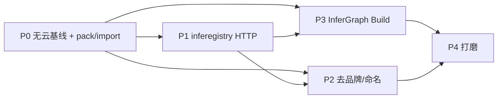

# InferGraph 分阶段开发计划

> 依据：`需求.md`  
> 目标：在本 fork（`muzhix/inference` / 上游 `roboflow/inference`）上打造 **InferGraph**——协议兼容 Roboflow、运行时完全离线、自建 Registry、开源 Build、无 Roboflow 云与品牌依赖。  
> 文档性质：**可执行开发计划**（任务拆解、入口索引、验收与风险），非 API 详设。  
> 许可红线：不修改、不捆绑、不 redistribute `inference/enterprise/` 与 `inference_cli/lib/enterprise/`。

---

## 0. 计划总览

### 0.1 成功定义（主线完成条件）

与 `需求.md` §11 对齐，全部满足即视为主线完成：

1. 断网 + 无 Roboflow 账号：Registry 注册/导入模型 → Build 编排 Workflow → 本地推理。
2. `pack` / 手工 InferGraph 模型包可加载；官方 Roboflow cache/workflow 可导入。
3. `inferegistry/` HTTP 服务替代云端元数据与权重分发；运行时永不回落 Roboflow。
4. InferGraph Build（React + shadcn/ui + React Flow）完成主流可视化编排，不加载 `*.roboflow.com` 前端。
5. 默认部署面为 InferGraph 品牌；`ROBOFLOW_*` 逐步去除；协议层保持兼容。
6. 发行物不含 Enterprise 许可代码。

### 0.2 阶段地图


| 阶段 | 主题 | 需求 | 产出物 | 依赖 |
| --- | --- | --- | --- | --- |
| **P0** | 无云离线推理基线 | R1、R2 | 无云模式语义、pack/import 工具、禁云 fallback、smoke 验收 | 现有 `OFFLINE_MODE` + 双栈 cache 读路径 |
| **P1** | InferGraph Registry | R3 | `inferegistry/` HTTP 服务 + Inference 侧对接 | P0 pack/import 与协议包格式 |
| **P2** | 去品牌与命名迁移 | R5 | InferGraph 默认表面、环境变量别名/迁移 | 与 P0/P1 交叉；不阻塞 P3 |
| **P3** | InferGraph Build | R4 | React 可视化编辑器，替换 `BUILDER_ORIGIN` 云端 UI | P0 本地 CRUD/schema；P1 模型枚举更佳 |
| **P4** | 体验与生态打磨 | R4/R5 增强 | 导入导出 UX、模板、文档、发行物硬化 | P0–P3 主线可用 |


### 0.3 设计原则（贯穿各阶段）

1. **复用优先**：Workflow 引擎、Block、`dump_model_config_for_offline_use`、`/build/api`、`air_gapped` 扫描一律复用；禁止平行重写。
2. **协议兼容、运行时无云**：字段名/包格式保持 Roboflow-compatible；任何路径不得回落 `api.roboflow.com` / `*.roboflow.com`。
3. **新写 inference-models，旧读 traditional**：`models-cache` + `model_config.json` 为唯一新写入；读路径双栈兼容至迁移完成。
4. **最小必要集**：Registry 映射只保留 `model_id → (task, arch) → loader`；删除计费、租约、Secure Gateway 默认路径、Universe。
5. **Enterprise 隔离**：默认加载与 Docker 发行不打包 `inference/enterprise/`。
6. **可验证**：每阶段留最小可跑检查（单测或脚本），断网场景用防火墙/抓包验收。

### 0.4 推荐仓库布局（目标态）

```
/
├── inference/              # 核心库（改：env、registry 对接、品牌默认）
├── inference_models/       # 模型栈（改：weights provider 指向 Registry）
├── inference_cli/          # CLI（改：无云默认；可选 pack 入口）
├── inference_sdk/          # SDK（后置：品牌/文档）
├── inferegistry/           # 【新建】独立 HTTP Registry + pack/import
├── infergraph-build/       # 【新建】React Build 前端（或 packages/build）
├── docker/                 # InferGraph 默认镜像（无 enterprise）
├── 需求.md
└── plan.md                 # 本文档
```

前端目录名可在 P3 开工时定为 `infergraph-build/` 或 `packages/build/`，计划内统一称 **InferGraph Build**。

---

## 1. P0 — 无云离线推理基线（R1、R2）

### 1.1 目标

在**不引入完整 Registry UI** 的前提下，做到：

- 运行时零 Roboflow 云请求（含 Secure Gateway→Roboflow）。
- 可用工具把权重变成合规 InferGraph 模型包并推理。
- Cache miss **失败或查本地 Registry 配置**，永不打 Roboflow。

P0 可先用「本地文件 Registry / 指向 `file://` 或后续 P1 服务」的配置钩子；HTTP Registry 本体在 P1。

### 1.2 现状可复用能力


| 能力 | 入口 |
| --- | --- |
| Offline 闩锁与连带关闭 telemetry / remote step | `inference/core/env.py`（`OFFLINE_MODE`） |
| Cache miss 时禁止 HTTP | `roboflow_api._get_from_url`、weights provider offline hard-fail |
| 双栈扫描 | `inference/core/cache/air_gapped.py` |
| Offline manifest 写入 | `dump_model_config_for_offline_use`（`inference_models/.../auto_loaders/core.py`） |
| Traditional / models-cache 路径 | `model_artifacts.py`、`model_cache_paths.py` |
| Workflow 本地存储 | `$MODEL_CACHE_DIR/workflow/local/` + `/build/api` |
| Remote 执行拒绝 | `workflows/offline.py` |


### 1.3 任务拆解

#### P0-T1：无云模式语义升级

**做什么**

1. 明确「InferGraph 无云模式」与现有 `OFFLINE_MODE` 的关系：
   - **短期**：以 `OFFLINE_MODE=True` 为一等公民默认（InferGraph 发行镜像 / compose）；文档称「无云模式」。
   - **可选增强**：增加 `INFERGRAPH_CLOUDLESS=True`（或等价）作为产品开关，内部映射到现有 offline 闩锁 + 额外禁云检查；避免立刻重命名全部 `OFFLINE_*`。
2. 审计并切断「非 OFFLINE 但默认仍指向 Roboflow」的启动路径：
   - 默认 `API_BASE_URL` / `ROBOFLOW_API_HOST` 在 InferGraph 发行配置中改为空、本地占位或要求显式设置（P1 填 Registry URL）。
   - `HOSTED_*_URL`、`METRICS_*`、version check、Active Learning：默认关或指向无效本地。
3. Cache miss：保持 hard-fail；错误信息改为引导「使用 InferGraph pack / Registry」，不提 Roboflow 控制台。

**入口文件**

- `inference/core/env.py`
- `inference/core/roboflow_api.py`
- `inference/core/registries/roboflow.py`（`get_model_type` miss 分支）
- `inference_models/.../weights_providers/roboflow.py`
- Docker / compose / 示例 env（`docker/dockerfiles/`、文档）

**完成标准**

- [ ] InferGraph 默认配置下进程启动不请求任何 `*.roboflow.com`。
- [ ] `OFFLINE_MODE`（或产品开关）下 miss 只报本地错误，无重试打云。

#### P0-T2：`pack` — 生成 InferGraph 模型包

**做什么**

在即将新建的 `inferegistry/`（P0 可先放 CLI/库，HTTP 后置）提供：

```
pack: 权重 + class_names + task/architecture [+ inference_config]
    → models-cache 合规包（调用 dump_model_config_for_offline_use）
    → 写入 MODEL_CACHE_DIR/models-cache/...
    → （P1）同步注册到 Registry；P0 可只写盘
```

最小输入建议：

| 参数 | 说明 |
| --- | --- |
| `--model-id` | 如 `my-det/1` |
| `--weights` | `.pt` / `.onnx` / `.engine` |
| `--task` / `--architecture` | 与 loader 注册表一致 |
| `--class-names` | 文件或列表 |
| `--inference-config` | 可选 JSON |
| `--cache-dir` | 默认 `MODEL_CACHE_DIR` |

**非目标**：无 metadata 的裸权重魔法加载。

**入口 / 参考**

- 写入：`dump_model_config_for_offline_use`
- 布局：`inference_models/.../auto_loaders/model_cache_paths.py`
- 协议说明：`inference_models/docs/how-to/roboflow-model-packages.md`
- 新代码：`inferegistry/`（建议 `inferegistry/pack.py` + CLI）

**完成标准**

- [ ] `pack` 产出可被 `get_model_type` + 推理 API 在无 API key、断网下加载。
- [ ] 至少一条检测模型（YOLO 系或仓库内已有 foundation）端到端 smoke。

#### P0-T3：`import-roboflow-cache` / `import-workflow`

**做什么**

1. **`import-roboflow-cache`**：接受官方 warm 的 traditional（`model_type.json`）或 `models-cache` / 平台导出包目录；校验后拷入本地 cache；traditional **只读兼容**，可选记录「待 convert」。
2. **`import-workflow`**：Roboflow workflow JSON → `$MODEL_CACHE_DIR/workflow/local/`（复用现有落盘约定）。
3. **`convert`（可选，P0 末或 P1）**：traditional → inference-models（补齐 `model_config.json`）。

**完成标准**

- [ ] 导入一份官方 Roboflow cache 后，断网无 API key 可推理。
- [ ] 导入 workflow JSON 后 `/workflows/run` 或 `/build/api/{id}` 可读。

#### P0-T4：禁云 fallback  hardening

**做什么**

对以下路径做「无云断言」单测或集成检查：

| 路径 | 期望 |
| --- | --- |
| `get_model_type` cache miss | 不发起 Roboflow HTTP |
| weights download | 不下载 |
| telemetry / metrics | 不发送 |
| Workflow `StepExecutionMode.REMOTE` | 拒绝 |
| URL 读图（若 offline 已禁） | 保持拒绝 |
| Secure Gateway | 不作为「离线替代」；无云模式下不启用到 Roboflow 的代理 |

实现手段优先：**配置默认值 + 现有 offline 守卫**；必要时在 `roboflow_api` / weights provider 增加 InferGraph 发行下的显式 `raise`（域名 allowlist 为空）。

**完成标准**

- [ ] 单测或脚本：mock 网络后跑 infer，零外呼。
- [ ] 文档声明：用户自定义 Block 自联网不在约束内；硬 air-gap 靠 OS。

#### P0-T5：文档与最小验收脚本

**做什么**

1. 对外只描述一种包：`InferGraph 模型包`（= inference-models / 平台包结构）。
2. 写 `docs/` 或根级简短 `OFFLINE.md`：预热/pack → 断网 → 推理三步。
3. 最小 smoke：`scripts/` 或 `tests/` 下 assert-based 检查（ponytail：一个可跑检查即可）。

### 1.4 P0 验收清单（阶段门禁）

- [ ] 断网 + 无 API key：本地 cache hit 推理成功。
- [ ] `pack` 新模型可推理；官方 cache 可 import。
- [ ] 抓包/防火墙下内置路径无 Roboflow 域名请求。
- [ ] Workflow `workspace=local` 可跑含模型步的定义。
- [ ] 未触碰 `inference/enterprise/`。

### 1.5 P0 风险


| 风险 | 缓解 |
| --- | --- |
| 双栈扫描遗漏导致 import 后「看不见」 | 复用 `air_gapped.scan_cached_models`；用其做 import 后校验 |
| `dump_model_config_for_offline_use` 字段不全导致 offline 校验失败 | pack 强制填 `model_id`、`canonical_model_id`、`package_artifacts`、hash |
| InferGraph 默认改 URL 破坏上游兼容测试 | 用发行 profile / env 文件隔离，单测矩阵保留「兼容模式」 |

---

## 2. P1 — InferGraph Registry（R3）

### 2.1 目标

新建与 `inference/` 同级的 **`inferegistry/`** 独立 HTTP 服务，替代 `api.roboflow.com` 的模型元数据与权重分发；Inference 进程将 `API_BASE_URL` / `ROBOFLOW_API_HOST` 指向该服务，**无云 fallback**。

### 2.2 协议兼容范围（必须对齐）

优先兼容现有客户端已调用的形状（勿发明平行协议）：


| 客户端入口 | 现网/上游调用 | Registry 应对齐 |
| --- | --- | --- |
| `get_model_metadata_from_inference_models_registry` | `GET .../models/v1/external/stat` | 元数据 |
| weights provider `get_roboflow_model` | `.../models/v1/external/weights` | 分页包列表 + 下载 URL |
| legacy `get_roboflow_model_data` | `/ort/...`、`getWeights` | **P1 可只支持新栈**；traditional 靠 import 写盘即可 |

下载 URL 指向 Registry 自身或受控本地/HTTP；**禁止**默认 Roboflow CDN/S3。

### 2.3 任务拆解

#### P1-T1：`inferegistry` 包骨架

**做什么**

1. `uv` 初始化 `inferegistry/`（PEP 621 + lock）；独立可运行进程。
2. 建议栈：FastAPI 或 Starlette（与 inference HTTP 习惯接近即可）；存储首版用 **文件系统 + JSON 索引**（YAGNI：不上独立 DB，除非运维强需求）。
3. 配置：`INFERGRAPH_REGISTRY_ROOT`（模型包根）、`HOST`/`PORT`、可选 token。
4. Docker Compose 片段：`inference` + `inferegistry` + 共享 volume（`MODEL_CACHE_DIR`）。

**目录示意**

```
inferegistry/
├── pyproject.toml
├── README.md
├── inferegistry/
│   ├── __init__.py
│   ├── app.py              # HTTP app
│   ├── store.py            # 索引与包落盘
│   ├── pack.py             # 从 P0 迁入/完善
│   ├── import_cache.py
│   ├── import_workflow.py
│   ├── api/
│   │   ├── models.py       # register/list/delete/validate
│   │   └── compat.py       # external/stat、external/weights
│   └── cli.py
└── tests/
```

#### P1-T2：兼容协议端点

**做什么**

实现最小集：

1. `GET /models/v1/external/stat`（或客户端实际路径）— 按 `model_id` 返回 task/architecture/metadata。
2. `GET /models/v1/external/weights` — 分页返回 package 元数据与**本地可下载** URL。
3. 静态/受控下载路由：`GET /artifacts/{...}`（路径穿越防护：`cache_path_is_within_root` 同类校验）。

**简化（明确不做）**

- API key 工作区解析、credits、service_secret、租约 expiration、Secure Gateway、Universe。

#### P1-T3：注册 API / CLI

**做什么**

| API / CLI | 行为 |
| --- | --- |
| `POST /v1/models` 或 CLI `register` | 注册已 pack 的包 |
| `GET /v1/models` | 列表 |
| `DELETE /v1/models/{id}` | 删除索引与可选文件 |
| `POST /v1/models/validate` | 校验 manifest / artifacts |
| CLI `pack` / `import-roboflow-cache` / `import-workflow` | 完善 P0 工具并写入 Registry 索引 |

#### P1-T4：Inference 侧对接

**做什么**

1. InferGraph 默认：`API_BASE_URL` + `ROBOFLOW_API_HOST`（及后续 InferGraph 别名）→ Registry。
2. Cache miss → 只问 Registry；失败即失败，**无 Roboflow 回落**。
3. 可选：`register_weights_provider("infergraph", ...)` 包装同一协议，逐步替代硬编码 `"roboflow"` 名称（产品层改名，协议字段可仍兼容）。
4. `/build/api/models`：继续扫本地 cache，并可选合并 Registry 列表。

**入口**

- `inference/core/registries/roboflow.py`
- `inference/core/roboflow_api.py`
- `inference_models/.../weights_providers/roboflow.py` / `core.py`
- `inference/core/interfaces/http/builder/routes.py`

#### P1-T5：映射逻辑瘦身

**做什么**

在 Inference 侧按 `需求.md` §7.3.2：

| 保留 | 外置/删除 |
| --- | --- |
| `model_id → (task, arch)` | 云端 miss 拉取、工作区 API key 解析 |
| `(task, arch) → loader` | Secure Gateway / credits / secret |
| 本地 manifest 查找与校验 | 计费、租约 |
| 精简常用 alias | 双份 SDK alias 强同步（可收敛） |

原则：**能不动 loader 注册表就不动**；只改「从哪取 metadata」。

### 2.4 P1 验收清单

- [ ] 新模型仅经 Registry + cache 导入，全程不接触 Roboflow。
- [ ] 现有 Workflow 中 `model_id` block 在协议兼容下仍可运行。
- [ ] 官方导出 cache/workflow 可经 import 进入系统。
- [ ] 断网：Registry 与 Inference 同机/同网，外网拒绝时仍可用。
- [ ] 路径穿越与任意文件读被拒绝。

### 2.5 P1 风险


| 风险 | 缓解 |
| --- | --- |
| 协议字段与客户端解析不完全一致 | 用真实客户端函数做契约测试（录一版上游响应 fixture，Registry 对齐） |
| 双 URL（`API_BASE_URL` vs `ROBOFLOW_API_HOST`）漏改一侧 | Compose/文档强制同值；加启动检查 |
| 与 `OFFLINE_MODE` 互斥（offline 禁止一切 HTTP） | 区分「禁止公网」与「允许访问本机 Registry」：无云模式允许 loopback/配置的 Registry host allowlist |

> **关键产品决策（P1 开工前确认）**：`OFFLINE_MODE` 当前禁止所有内置 Roboflow HTTP。InferGraph「无云」需要 **允许访问自建 Registry**。实现建议：在 offline/cloudless 守卫中增加 **显式 allowlist**（Registry base URL），而非关闭整个 `OFFLINE_MODE`。

---

## 3. P2 — 去品牌与 `ROBOFLOW_*` 迁移（R5）

### 3.1 目标

默认部署与用户可见表面呈现 **InferGraph**；环境变量与代码前缀逐步去 `ROBOFLOW_*`；协议层保留兼容字段名。

可与 P0/P1 **交叉进行**，按优先级推进，不阻塞 P3 开工。

### 3.2 优先级与任务

#### P2-T1：运行时默认 URL / Header（高）

| 项 | 动作 |
| --- | --- |
| `API_BASE_URL` / `ROBOFLOW_API_HOST` | InferGraph 发行默认 → Registry |
| `BUILDER_ORIGIN` | → InferGraph Build 源（P3 前可暂本地静态） |
| `HOSTED_*_URL` | 默认空/禁用 remote |
| `METRICS_*` / OTEL | 默认关 |
| `X-Roboflow-*` 等 Header | 迁移期兼容读取，写出改为中性或 InferGraph |

提供兼容别名：例如 `INFERGRAPH_API_KEY` 读入后仍填内部 `api_key` 字段；迁移期可读旧 `ROBOFLOW_API_KEY`。

#### P2-T2：OpenAPI / Landing / 错误文案（高）

- OpenAPI title、contact、ToS → InferGraph。
- Landing / banner 文案去 Roboflow 营销标识。
- 用户可见错误与 CLI help 指向 InferGraph 文档。

#### P2-T3：云 sink blocks（中）

对直连 Roboflow 的 upload / monitoring / vision events 等：

- **删除**，或
- **默认禁用**的可选插件（需显式 enable）。

不引入 Enterprise 目录中的工业 sink。

#### P2-T4：文档与主题站（低，可后置）

- CDN / Universe / docs.roboflow.com 链接清理或改为「兼容说明」专页。
- 开发者文档保留「Roboflow-compatible protocol」章节。

#### P2-T5：命名策略落地检查表


| 层 | 策略 |
| --- | --- |
| 协议 / 包字段 | 保留兼容名 |
| 产品 / UI / OpenAPI | InferGraph |
| 环境变量 | 新名优先 + 旧名 deprecated 别名 → 最终删除 |
| Python 模块名（如 `roboflow_api.py`） | **不强制 P2 重命名**（噪音大）；可先加 facade，P4 再评估 |

### 3.3 P2 验收清单

- [ ] 新部署无需任何 Roboflow 账号 / API key。
- [ ] 主要用户可见表面为 InferGraph。
- [ ] 协议兼容说明仅在开发者文档出现。
- [ ] CI：发行镜像/配置扫描无硬编码 `api.roboflow.com` 作为默认（测试 fixture 除外）。

---

## 4. P3 — InferGraph Build（R4）

### 4.1 目标

开源实现可视化 Workflow 构建：技术栈 **React + shadcn/ui + React Flow**；先嵌入现有 iframe 壳（`postMessage` + `serverUrl`），再渐进原生挂载。

### 4.2 已具备后端（不要重做）


| 能力 | 接口 |
| --- | --- |
| Blocks schema / air-gapped | `GET /workflows/blocks/describe?air_gapped=true` |
| Definition schema | `GET /workflows/definition/schema` |
| 校验 / 运行 / 动态输出 | `/workflows/validate`、`/workflows/run`、`/workflows/blocks/dynamic_outputs` |
| 本地 CRUD | `/build/api`、`/build/api/{id}` |
| 本地模型列表 | `/build/api/models` |
| iframe 壳 | `builder/editor.html` |

### 4.3 分里程碑

#### P3-M1：可嵌入的最小编辑器（MVP）

**做什么**

1. 新建前端工程；开发服务器与静态构建产物可被 `BUILDER_ORIGIN` 指向。
2. 实现与现有壳的契约：`serverUrl`、CSRF、`postMessage`（`navigate` / `setTitle`）按需兼容。
3. 画布：React Flow 节点 = Block；边 = 输入输出连线。
4. 从 `/workflows/blocks/describe` 拉清单；拖拽添加；基础参数表单（shadcn）。
5. 保存/加载走 `/build/api`；导出 JSON。

**验收**

- [ ] `ENABLE_BUILDER=True`，`BUILDER_ORIGIN` 指向本地 Build，浏览器不加载 `app.roboflow.com`。
- [ ] 空白画布 → 选 1 个模型 block + 1 个可视化 block → 保存 → validate/run 成功（模型已在 cache）。

#### P3-M2：Schema 驱动表单与试跑体验

**做什么**

1. 端口类型、kinds、默认值、校验错误在画布/侧栏可读展示。
2. 对接 validate/run；失败定位到节点。
3. `air_gapped_info.available=false` 的 block：禁用或明确标注。
4. 模型选择器：Registry（P1）+ `/build/api/models`。

#### P3-M3：去云嵌入与品牌

**做什么**

1. 默认 `BUILDER_ORIGIN` → InferGraph Build（同域静态或独立服务）。
2. UI 品牌 InferGraph；移除 Roboflow 营销标识。
3. CORS（`http_api.py` 中对 `BUILDER_ORIGIN` 的配置）与 CSRF 回归测试。

#### P3-M4（可选本阶段）：原生挂载

去掉 iframe，Inference 直接 serve 构建产物；保留 `postMessage` 兼容不是必须。

### 4.4 非目标（本阶段不做）

- 像素级复刻商业 UI。
- Universe 模板市场、云协作、标注闭环。
- Enterprise 专有 blocks。

### 4.5 P3 验收清单

- [ ] 仅用 InferGraph Build 完成「模型推理 + 可视化」Workflow，保存后断网可重复运行。
- [ ] 不加载任何 `*.roboflow.com` 前端资源。
- [ ] 导入 Roboflow workflow JSON 可编辑（能力边界在文档标明）。

### 4.6 P3 风险


| 风险 | 缓解 |
| --- | --- |
| Block schema 复杂度导致表单爆炸 | MVP 只支持常见 JSON/标量/选择器；复杂 kind 用 JSON 编辑兜底 |
| CSRF / CORS / cookie 跨源坑 | 先同域或严格按现有 `serverUrl`+CSRF 模式 |
| 与 execution engine 版本耦合 | 前端只信 describe/schema，不硬编码 block 列表 |

---

## 5. P4 — 体验与生态打磨

### 5.1 目标

主线可用后的体验、文档、发行与可选生态，不阻挡 P0–P3 宣告「主线完成」。

### 5.2 任务候选（按需排序）

1. **导入导出 UX**：Build 内一键 import Roboflow JSON / 导出 InferGraph 包。
2. **模板库**：若干本地示例 Workflow（检测+可视化、分类等），存仓库非云端。
3. **`convert` 工具产品化**：消化 traditional cache。
4. **权限（若需要）**：Registry/Build 简单 token；不做 SaaS 多租户。
5. **发行物硬化**：
   - Docker 默认 InferGraph 品牌与无云配置。
   - 构建脚本排除 `inference/enterprise/`。
   - AGPL 等模型许可证分发审查清单。
6. **文档站点**：部署/pack/Registry/Build 四篇核心文档。
7. **命名清理尾声**：删除 deprecated `ROBOFLOW_*` 别名（major 版本）。
8. **SDK / CLI** 表面同步 InferGraph 命名与默认 endpoint。

### 5.3 P4 验收（增强项）

- [ ] 新用户按文档 30 分钟内：装服务 → pack 模型 → Build 编排 → 断网复跑。
- [ ] 发行扫描：无 enterprise 目录；默认无 Roboflow URL。

---

## 6. 跨阶段工作流与工程约定

### 6.1 建议迭代顺序（依赖图）



- **P3 可在 P1 完成前用纯本地 cache 开工**（`/build/api/models`），模型选择器在 P1 后增强。
- **P2 从 P0 起随手改默认值**，不必等单独大爆炸 PR。

### 6.2 测试策略


| 层级 | 内容 |
| --- | --- |
| 单测 | pack manifest 字段；import 路径；Registry 契约；offline allowlist；无云 miss |
| 集成 | compose：Registry + Inference；断网脚本；`/workflows/run` |
| 手工 | Build 画布 MVP；抓包确认无 `*.roboflow.com` |
| 回归 | 上游兼容：`OFFLINE_MODE` 原行为；traditional cache 仍可读 |

命令习惯（本仓）：

```bash
pytest tests/inference/unit_tests/ -q
pytest tests/workflows/unit_tests/ -q
# 新增
pytest inferegistry/tests/ -q
```

### 6.3 PR / 分支建议

| 主题 | 分支示例 |
| --- | --- |
| P0 pack + 无云默认 | `cursor/p0-cloudless-pack-*` |
| P1 Registry | `cursor/p1-inferegistry-*` |
| P2 品牌 | `cursor/p2-rebrand-*` |
| P3 Build MVP | `cursor/p3-build-mvp-*` |

每阶段一个可演示里程碑再合入；避免「Registry+Build+重命名」巨型 PR。

### 6.4 许可与合规检查（每阶段末）

- [ ] diff 未引入 `inference/enterprise/` 或 `inference_cli/lib/enterprise/` 内容。
- [ ] 新增依赖许可证可接受。
- [ ] 捆绑权重/模型代码的 copyleft 已记录。

---

## 7. 关键代码索引（开发入口速查）


| 主题 | 路径 |
| --- | --- |
| Offline / 环境变量 | `inference/core/env.py` |
| Air-gapped 扫描 | `inference/core/cache/air_gapped.py` |
| Traditional cache | `inference/core/cache/model_artifacts.py` |
| 云端 API 客户端 | `inference/core/roboflow_api.py` |
| Model registry 映射 | `inference/core/registries/roboflow.py`、`inference/models/aliases.py`、`inference/models/utils.py` |
| Offline manifest | `inference_models/.../auto_loaders/core.py` → `dump_model_config_for_offline_use` |
| models-cache 路径 | `inference_models/.../auto_loaders/model_cache_paths.py` |
| Weights provider | `inference_models/.../weights_providers/roboflow.py`、`core.py` |
| Builder 壳 / API | `inference/core/interfaces/http/builder/` |
| Workflow HTTP | `inference/core/interfaces/http/handlers/workflows.py` |
| Remote 守卫 | `inference/core/workflows/offline.py` |
| Enterprise（避开） | `inference/enterprise/`、`inference_cli/lib/enterprise/` |
| Registry（新建） | `inferegistry/` |
| 需求原文 | `需求.md` |


---

## 8. 阶段完成定义（Definition of Done）

每个阶段合入主线前必须：

1. 对应 § 验收清单全部勾选（或文档标明明确延期项）。
2. 新增/修改路径有最小自动化检查。
3. 更新用户可见文档中与该阶段相关的操作步骤。
4. 无 Enterprise 目录污染；无运行时 Roboflow 回落。
5. 演示路径可复述：输入（包/JSON）→ 命令 → 断网结果。

---

## 9. 待决问题（开工前确认）


| # | 问题 | 建议默认 |
| --- | --- | --- |
| 1 | 无云模式下是否允许访问本机/内网 Registry？ | **允许**，host allowlist；禁止其余出网 |
| 2 | InferGraph Build 仓库位置 | 单仓 `infergraph-build/`，便于与 schema 同步 |
| 3 | Registry 鉴权首版 | 可选 shared token；默认信任内网 |
| 4 | 是否保留「兼容模式」一键指向真实 Roboflow | **不保留运行时回落**；开发者若需对比上游，用上游项目，不进 InferGraph 默认 |
| 5 | `ROBOFLOW_*` 删除时间点 | P2 引入别名；P4/major 删除 |


---

## 10. 近期执行清单（建议从这里开工）

**第一个可交付切片（P0 竖切）：**

1. 建 `inferegistry/` 最小包：仅 `pack` + 写 `models-cache`（可无 HTTP）。
2. InferGraph compose/env：`OFFLINE_MODE=True`，默认 URL 不指向 Roboflow。
3. Smoke：pack 检测模型 → `GET /model_id/infer` 或 workflows run → 断网重复。
4. `import-roboflow-cache` 读一条 traditional 或 models-cache 样例。
5. 补「无云 miss / 无外呼」单测。

完成后进入 P1：给 `inferegistry` 加上 `external/stat` + `external/weights`，并把 Inference 的两个 base URL 指过去（含 offline allowlist）。

---

*本计划随实现演进；若与 `需求.md` 冲突，以已拍板决策（需求 §4）为准，并回写更新本文件。*
